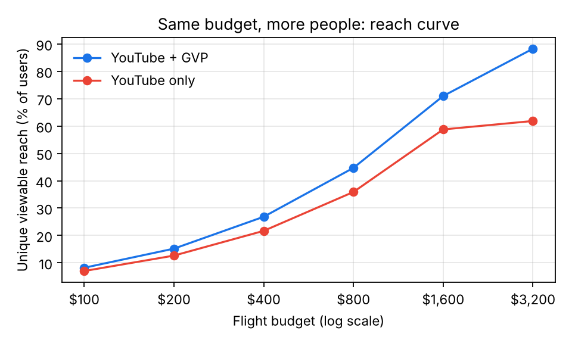
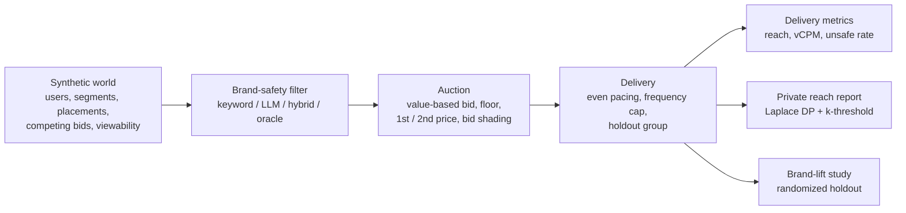
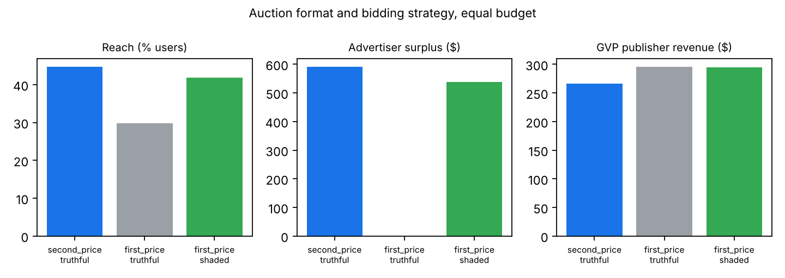
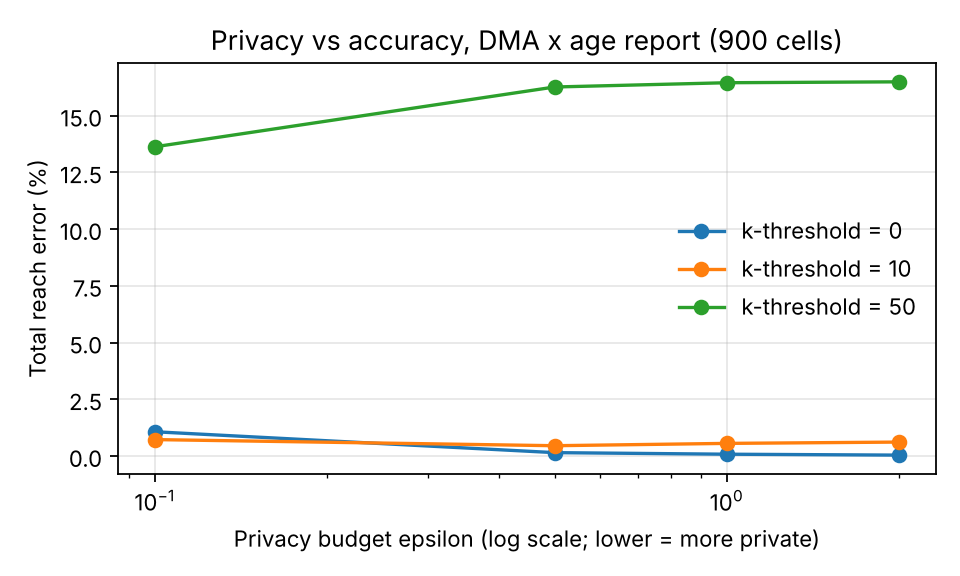

# GVP Brand Reach Lab

A simulation sandbox for one product question:

> **When a YouTube brand campaign extends to third-party video publishers (Google Video Partners), how much incremental reach does it buy, and what does it take to keep that reach brand-safe, efficiently priced and measurable without exposing user-level data?**

The lab simulates 200K users, 5,200 video placements and ~2.9M ad opportunities per run, then plays a brand campaign through real auction mechanics (floors, first and second price, bid shading, pacing, frequency caps), a brand-safety filter, and a privacy-safe measurement layer. Every scenario in a run shares the same simulated world, so differences come from the policy being tested, not from noise.

All data is synthetic. The numbers are directional evidence for product trade-offs, not estimates of any real platform.



---

## The product problem

Extending brand demand beyond YouTube is attractive because some audiences watch little YouTube but plenty of video elsewhere. It also creates four tensions a PM has to resolve together:

| Tension | Question the lab answers |
|---|---|
| **Reach vs. cost** | At an equal budget, how much unique reach does GVP add, and at what viewable CPM? |
| **Brand safety vs. scale** | Do keyword blocklists protect advertisers, or do they block good publishers and still leak bad inventory? |
| **Auction mechanics** | What happens to advertisers and publishers when the auction moves from second price to first price? |
| **Measurement vs. privacy** | Can we prove incremental reach with differentially private, aggregated reports, and where does accuracy break? |

## How it works



| Module | What it does |
|---|---|
| `gvplab/inventory.py` | Users in three viewing segments (YouTube-heavy, mixed, off-YouTube), YouTube and GVP placements across premium, long-tail and made-for-advertising supply, each with viewability, floor price and a ground-truth risk tier. About 25% of titles are deliberately "tricky": safe content with alarming words ("shooting in golden hour", "bath bomb") or risky content with none. |
| `gvplab/brand_safety.py` | Keyword blocklist baseline; an **LLM classifier** (OpenAI-compatible, Anthropic or Gemini) with a Pydantic-validated JSON verdict, per-title caching and fail-closed handling; a **hybrid router** that sends only the risky slice of supply to the LLM to control cost; decision-level evaluation (over-blocking vs. leakage). |
| `gvplab/auction.py` | Value-based bidding (value × predicted viewability × audience match), publisher floors, second-price and first-price auctions, **optimal bid shading** learned from historical competing bids, even budget pacing and frequency capping. |
| `gvplab/measurement.py` | Reach, frequency, vCPM and unsafe-impression rate; a reach report over a disjoint cell domain released with the **Laplace mechanism** and a **k-anonymity-style threshold**; a randomized **brand-lift** study with confidence intervals. |
| `gvplab/experiments.py` | Runs every scenario over 5 seeds and writes [`results/RESULTS.md`](results/RESULTS.md), CSVs and charts. |
| `app.py` | Streamlit demo: change budget, suitability, classifier, auction type and privacy settings and watch the trade-offs move. |

## Findings (5 seeds, equal $800 budget)

Full tables: [`results/RESULTS.md`](results/RESULTS.md). Headline numbers: [`results/headline.json`](results/headline.json).

**1. GVP buys incremental reach more cheaply.** Adding GVP inventory raised unique viewable reach by **24.6%** over YouTube-only at the same budget, cut viewable CPM by **10.6%** and cost per 1K reached users by **19.7%**. **39%** of the expanded campaign's reach came from people reached *only* on GVP; about half of those were in the off-YouTube segment, which is a quarter of all users.
*Implication:* position GVP Brand as a reach extension measured on incremental unique reach, not on CPM alone.

**2. Keyword blocklists fail in both directions.** Without a filter, **11.6%** of GVP-extended impressions land on content the advertiser's suitability setting excludes. A keyword blocklist cuts that to **2.3%**, but it does so by blocking 22% of opportunities: it wrongly blocks **14.4%** of genuinely suitable traffic (costing those publishers **~13.7%** of the revenue they would earn with accurate labels) while still letting **14.0%** of unsuitable traffic through. On tricky titles its decisions are right only **41.5%** of the time.
*Implication:* context-aware classification is a win for both sides of the marketplace. The hybrid router keeps LLM spend to the risky slice of supply.

**3. First-price auctions punish naive bidders.** Switching from second to first price with unchanged bids cut reach by **33%** and drove advertiser surplus to zero. Learned bid shading recovered most of it (reach **−6.4%** vs. second price, **+40%** vs. naive first price) while GVP publisher revenue rose **10.8%**.
*Implication:* any auction change needs buy-side bid automation shipped with it, or advertisers see a sudden drop in delivery.



**4. In private reporting, the threshold costs more than the noise.** At coarse granularity (age × region, 60 cells) differential-privacy noise is negligible. At DMA × age (900 cells), ε = 1 with a k = 10 threshold keeps total reach error at **0.6%**; raising the threshold to k = 50 suppresses **16.5%** of true reach and pushes error to **16.4%**.
*Implication:* advertisers can get incremental-reach proof without user-level data, but report granularity and thresholds must be set together, ideally per campaign size.



**5. Brand-lift studies are easy to under-power.** With a 10% holdout and 15% survey sample, the true lift (~1.4 pp) was detected as significant in only 2 of 5 runs.
*Implication:* size holdouts for the expected effect before launch, or default to reach-based proof for small campaigns.

## If this were a product launch

**Pilot design.** Geo-split pilot for GVP Brand: randomize DMAs into "YouTube only" vs. "YouTube + GVP" for opted-in advertisers, at equal budgets, for 4 weeks.

**Success metrics.**
- North star: incremental unique reach per dollar
- Guardrails: unsafe-impression rate below 0.5%; over-block rate on suitable supply below 5%; viewability above 70%
- Marketplace health: GVP publisher revenue, fill rate on premium supply
- Trust: share of campaigns with a reportable (non-suppressed) incremental-reach result

**Next steps.** Calibrate the LLM classifier on human-labeled samples and third-party verification data; add inventory filtering for made-for-advertising supply using viewability signals; test publisher first-party signals for walled-garden integrations as a targeting input.

## Assumptions and limitations

- All users, placements, prices and risk labels are simulated. Segment sizes, viewability distributions, floors and competing-bid levels are in `gvplab/config.py` and are meant to be changed.
- Competing bidders do not react to our campaign, which keeps runs exact and fast but ignores market feedback.
- The "context-aware (oracle)" scenario uses ground-truth labels. It is the **upper bound** a better classifier could reach, not a measured LLM result. Run the LLM evaluation below to get measured numbers.
- The lift model (diminishing returns in viewable frequency) is a stylized assumption.

## Quickstart

```bash
pip install -r requirements.txt
pytest -q                                   # 12 tests, ~2 s
python -m gvplab.experiments --seeds 5      # ~5 min, writes results/ and docs/
streamlit run app.py                        # interactive demo
```

### Evaluate an LLM brand-safety classifier

```bash
export GEMINI_API_KEY=...          # or OPENAI_API_KEY / ANTHROPIC_API_KEY
python -m gvplab.experiments --seeds 1 --llm gemini --llm-limit 150
```

This classifies up to 150 unique titles (cached in `results/llm_cache_<provider>.json`), compares keyword, LLM and hybrid classifiers on over-blocking, leakage and tricky-title accuracy, and appends the table to `results/RESULTS.md`.

## Repository layout

```
gvplab/
  config.py         market + campaign assumptions
  inventory.py      synthetic users, placements, opportunities
  brand_safety.py   keyword / LLM / hybrid classifiers + evaluation
  auction.py        bidding, auctions, shading, pacing, frequency cap
  measurement.py    metrics, DP reach report, lift study
  experiments.py    scenario runner, tables, charts
app.py              Streamlit demo
tests/              unit tests
results/            generated tables and headline numbers
docs/               generated charts
```

## License

MIT
